<!-- GitHub 个人主页 README：仓库名与用户名相同（RS-at/RS-at），本文件会显示在 https://github.com/RS-at 首页 -->

  

  

  
  
  

---

## 👋 关于我 · About Me

- 🔭 正在做：<!-- 填写你当前的项目 -->个人项目与技术积累
- 🌱 正在学：<!-- 填写正在学习的技术 -->新技术与工程实践
- 💬 可以聊：编程、工具、效率与开源
- 📫 联系方式：通过 GitHub Issues 或主页联系我
- ⚡ 座右铭：Stay curious, keep shipping.

## 🛠️ 技术栈 · Tech Stack

<!-- 按需增删，图标来自 https://skillicons.dev -->

  

## 📊 GitHub 统计 · Stats

  
  

  

  

---

  ⭐ 如果我的项目对你有帮助，欢迎 Star 支持！

